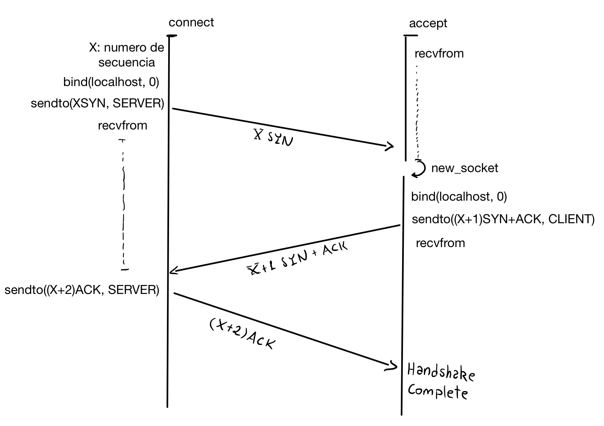
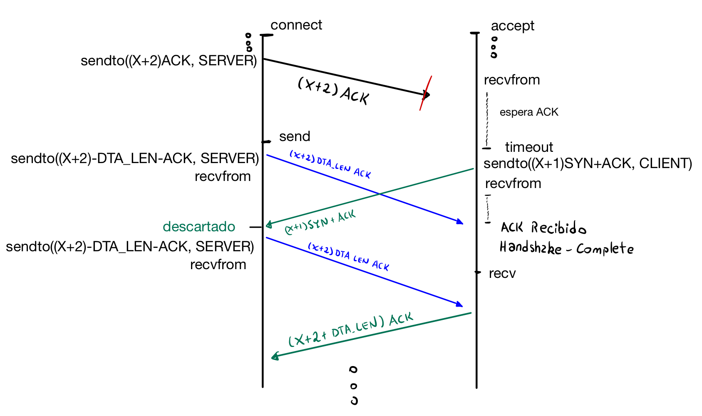

## Informe Actividad 3
**Gerald Ponce Díaz**

**github**: https://github.com/Gerlad64/Actividades-Redes-CC4303-

### Documentación y Diseño

#### Clases Definidas

**Segment.py/Segment**: Clase usada para almacenar segmentos TCP. Puede parsear desde bytes y convertir a bytes con los datos almacenados.
```python
class Segment(ctypes.BigEndianStructure):
    """ Segment
    Clase Segment para parsear segmentos de mensajes de
    comunicación TCP.
    """
    
    SEQ: int
    """Entero que almacena el número de secuencia"""
    ACK: int
    """bit que almacena la flag ACK"""
    SYN: int
    """bit que almacena la flag SYN"""
    FIN: int
    """bit que almacena la flag FIN"""
    DTA_LEN: int
    """Almacena el largo de los datos enviados aparte del segmento."""
```
Utiliza ctypes para poder controlar los bits y bytes asignados a cada parámetro. En particular,
`SEQ` ocupa los primeros 4 bytes, y el quinto byte se distribuye entre DTA_LEN, ACK, SYN y FIN:
`DTA_LEN` ocupa los primeros 5 bits, `ACK` ocupa el sexto, `SYN` el septimo y `FIN` el octavo, donde
si su bit está en 1 su bandera se considera activa.

**socketTCP.py/SocketTCP**: Clase que implementa TCP usando sockets UDP. Busca imitar la misma API de `socket`
para probar que un programa simple que funciona con `socket` también pueda funcionar con `SocketTCP`.
```python

@dataclass
class SocketTCP:
    """ Dataclass SocketTCP
    Implementa una versión simplificada del protocolo TCP usando sockets UDP por debajo.
    Presenta la misma API que la de sockets TCP de Python, aunque no con la funcionalidad completa
    en algunos casos. Esto con el propósito de hacer compatibles aquellos scripts que usan sockets
    de Python.
    """
    _bind_addr: tuple[str, int] = field(
        default=('notvalid', 8080),
        init=False
    )
    _conn_addr: tuple[str, int] = field(
        default=('notvalid', 8070),
        init=False
    )
    _socket: SocketType = field(
        default_factory=lambda: socket.socket(socket.AF_INET, socket.SOCK_DGRAM),
        repr=False,
        compare=False
    )
    _timeout: float | None = 1.0
    """timeout del socket"""
    _seq_id: int | None = None
    """Número de secuencia usado en la comunicación"""
    _remaining: int = 0
    """Datos que faltan por mandar"""
    _buffer: bytes = b''
    """Buffer que almacena un mensaje"""
```
Todas las variables son privadas, y se interacuan con ellas mediante métodos. De la misma forma que con `socket`
se debe hacer bind, accept o connect dependiendo si se es cliente o servidor.

#### Diseño de Headers
Cómo ya vimos, la clase `Segment`se encarga de los headers. Esta empaqueta la información utilizando
**5 bytes**. Para poder crear o recibir un segmento se llaman al `classmethod` `Segment.from_bytes` y al constructor `Segment()` respectivamente:
```python
def __init__(self, seq: int, flags: int = 0, len: int = 0) -> None:

@classmethod
def from_bytes(cls, seg: bytes, offset: int = 0) -> Segment:
```

Además los métodos solicitados `create_segment` y `parse_segment` son solo un wrapper de estos métodos:
```python
@staticmethod
def create_segment(seq: int, flags: int) -> Segment:
    """Crea un segmento"""
    return Segment(seq, flags)

@staticmethod
def parse_segment(seg: bytes, offset: int = 0) -> Segment:
    """Parsea bytes recibidos a un segmento"""
    return Segment.from_bytes(seg, offset)
```

#### Diseño de Socket

#### Implementación de `send` y `recv`

Para la transmisión y recepción de mensajes de tamaño variable se implementó *Stop & Wait* mediante las siguientes consideraciones:

**Transmisión (`send`):**
Se utiliza la porción `DTA_LEN` de la cabecera del mensaje para indicar el tamaño del **área de datos** de cada segmento mandado. 
El primer segmento corresponde al **largo total del mensaje** (en el área de datos), el cual tiene `DTA_LEN` de 8 (aunque en la mayoría de casos usa menos de 8 bytes).

Luego, el mensaje original se divide en fragmentos de hasta 16 *bytes*. Cada fragmento se envía utilizando una función interna, 
convenientemente llamada `_stop_and_wait`, que implementa stop & wait, es decir, 
se encarga de retransmitir iterativamente hasta recibir el `ACK` con la secuencia esperada.

**Recepción (`recv`):**
Se manejó la recepción fragmentada mediante variables privadas de `SocketTCP`:

* `_remaining`: Entero que almacena los bytes pendientes por recibir del mensaje actual.
* `_buffer`: Almacena temporalmente los datos recibidos que aún no se retornan a la aplicación.

Si `_remaining == 0` y el `_buffer` está vacío, el primer segmento recibido indica el tamaño del mensaje a procesar y se actualiza `_remaining`.

Posteriormente, se entra a un ciclo recibiendo datos hasta cumplir con la cantidad solicitada (`target = min(_remaining + len(_buffer), buff_size)`).

**Gestión de bytes sobrantes:**
Si el tamaño del mensaje recibido excede el `buff_size` solicitado, los datos son guardados en `_buffer` en lugar de descartarlos. Se retorna solo hasta el tamaño del buffer:

```python
msg, self._buffer = self._buffer[:target], self._buffer[target:] 
return msg
```

Esto asegura que la siguiente llamada a `recv` obtenga inmediatamente los bytes sobrantes directamente de `self._buffer` sin pérdida de datos en la capa de aplicación.


#### Información de DEBUG

* **Modo Debug y Pérdidas de red:** Se implementa un rastreo de eventos a través de prints, con prefijo `DEBUG:` y `WARNING:` para evidenciar el comportamiento ante pérdidas. Esto permite observar:

1. **Trazabilidad de secuencias:** En `_recv_seg()`, se imprime el número de secuencia recibido, el tamaño de los datos y la secuencia esperada (`esperado=self._seq_id`). Esto evidencia si el segmento recibido es nuevo, duplicado o externo.

2. **Timeout y Retransmisión:** Se imprimen mensajes cuando ocurre un `TimeoutError` en `_stop_and_wait` o durante el cierre de conexión, visibilizando la retransmisión de paquetes o el reenvío de `FIN` y `ACK`.

### Diagramas Solicitados
**Handshake sin pérdidas**:


**Pérdida de último ACK**:

En el último paso del handshake, el servidor solo espera recibir un ACK, ya que
el número de secuencia que guardará será el que llega por este mensaje. Entonces,
la solución propuesta es que `send` mande todos los segmentos con la flag ACK para que
`accept` pueda terminar el handshake. Esto no es problema, ya que `recv` no revisa las 
flags que le llegan.

### Dependencias y Entorno
Se probó con `python` 3.13 y 3.14 sin librerías externas, y en los sitemas operativos MacOS y Linux. 
Para otra versión de python se requiere soporte para las siguientes librerías nativas de python:
- socket
- dataclass **from** dataclasses
- ctypes

#### Configuración
Las configuraciones del servidor se encuentran en `config.py`.
Las más relevantes son las siguiente:
- **SERVER_IP** y **SERVER_PORT**: Se dejan tal cual como están en localhost, el puerto se puede cambiar a cualquiera.
- **SERVER_TIMEOUT** y **CLIENT_TIMEOUT**: Configura el timeout de los sockets para las pruebas. Se debe configurar uno
  adecuado para las pruebas con perdida de conexión, ya que ningún socket cierra la conexión automáticamente, y uno de 
  los dos puede quedarse pegado.
### Pruebas
- En una terminal ejecutar primero serverTCP.test.py y en otra clientTCP.test.py. Esto ejecuta los 
  tests sugeridos por el EOL, agregando pruebas de integridad, que verifican:
  1. Que cliente y servidor se reconozcan: Ambos tienen la dirección del otro
  2. Se pueden mandar mensajes pequeños: Uno que está dentro del tamaño del buffer y otro que lo exede un poco
  3. Pueden cerrar la conexión: Los puertos solicitados son liberados
  4. Se puede mandar un mensaje grande
- En una terminal ejecutar server.py y en otra client.py de esta forma:
  > python3 client.py < archivo.txt

  Esta es la aplicación solicitada, que puede mandar un texto desde el cliente al servidor

- Las pruebas con pérdida de conexión fueron probadas usando netem, con 20% de perdida, 0.5 de delay y 2.0 de timeout para ambos pares.
  Los resultados pueden variar.

### Casos Borde
- En esta implementación, se encontró que al intentar un mensaje grande de que ocupa más de 5 bits, almacenar el largo
  en del mensaje en el header ocasionaba un overflow y resultados inconsistentes. Este problema no fue detectado con los 
  tests de un mensaje de tamaño 19. Se solucionó mandando el tamaño del mensaje como un mensaje más. Esto si estaba en el 
  enunciado, pero no de forma tan evidente para haber atajado este overflow.


### Uso de IA
Para esta actividad he usado la IA para consultas sobre código, ayudarme a estructurar mi diseño, debug y generación de código mínima,
en particular, porciones de código que debían ser refactorizadas y ayudarme a inyectar prints para DEBUG.
 